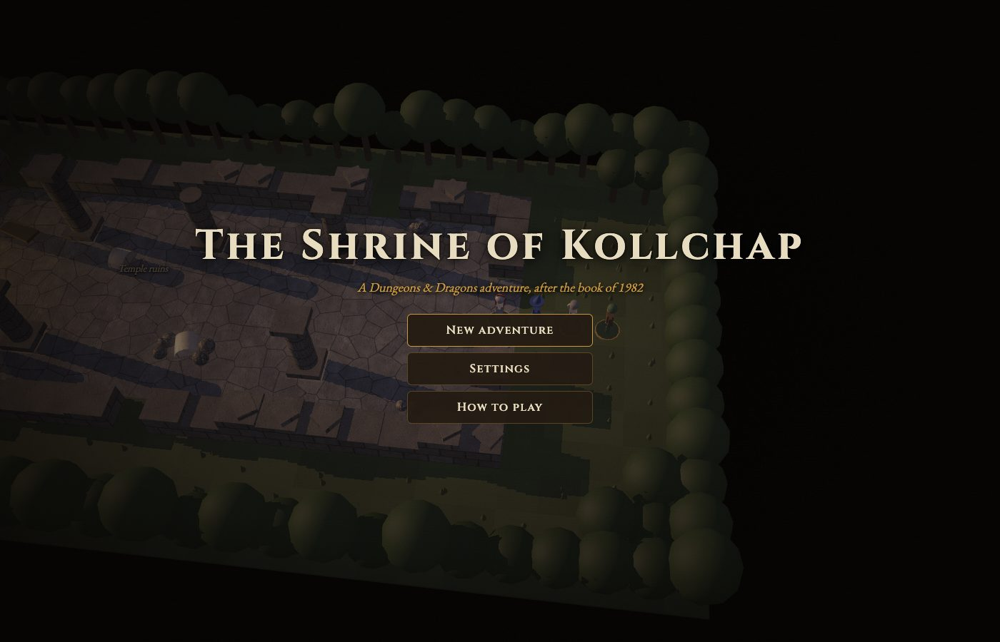
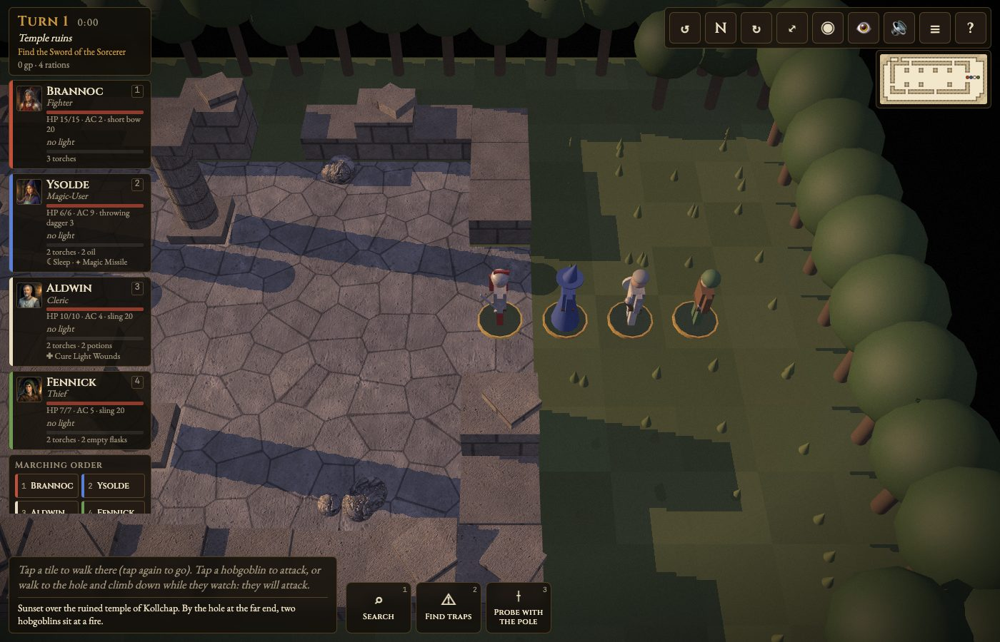
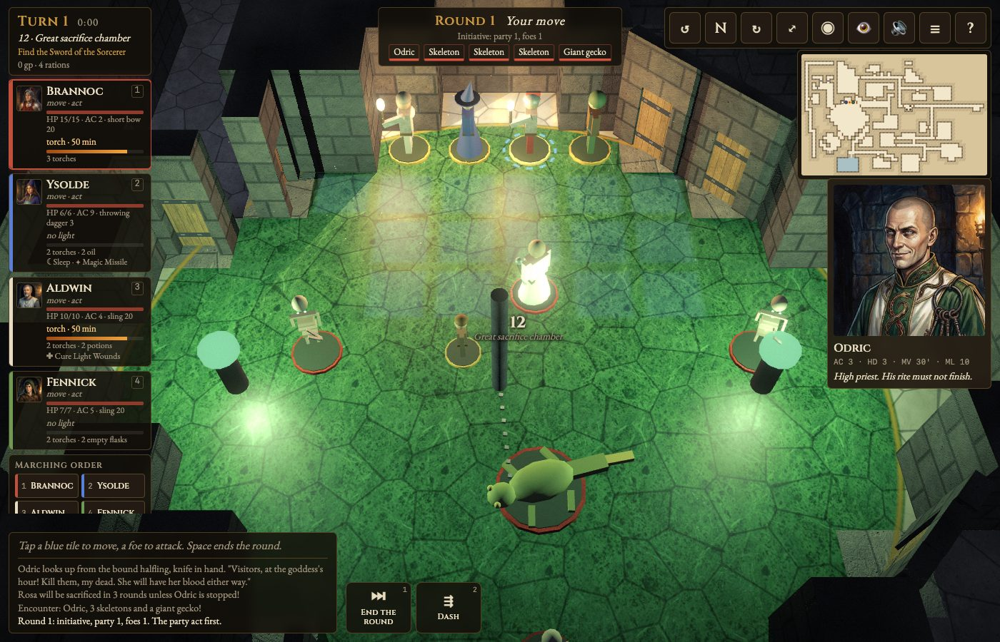
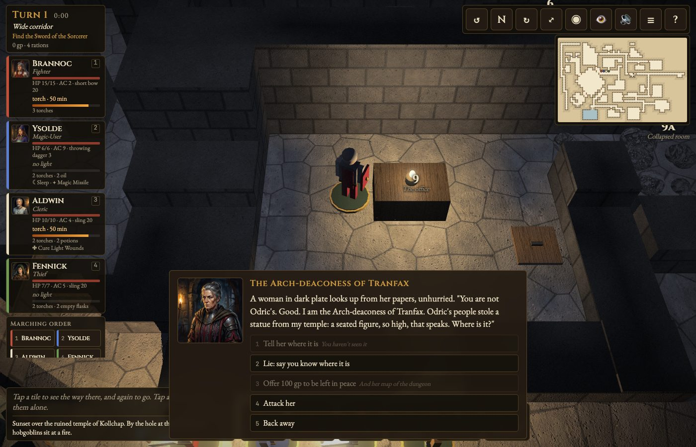
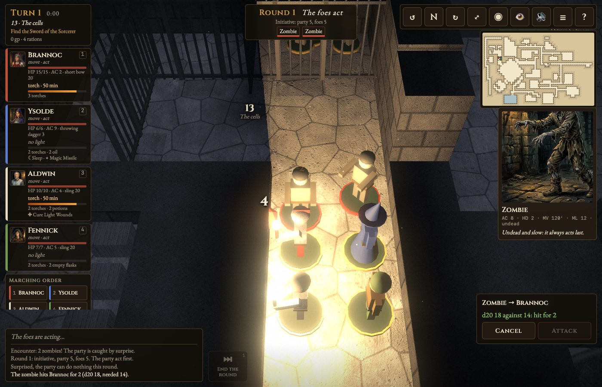

# The Shrine of Kollchap

A turn-based Dungeons & Dragons dungeon crawl in WebGPU, for desktop Chrome and iPad. It recreates the dungeon designed in *What Is Dungeons & Dragons?* (Penguin, 1982). The full design is in [PLAN.md](PLAN.md).

**Status: M0–M7 done, M8 (polish and ship) all but deployed.** The whole crawl plays, from the surface to the sword and back out, voiced, with a talking statue.



| | |
|---|---|
|  |  |
|  |  |

## Run it

```sh
npm run serve        # http://localhost:8080
npm test             # rules, map, set pieces, and bots that play the whole crawl (node:test, no dependencies)
```

WebGPU needs a secure page: `localhost` or HTTPS. There is no build step. The game is plain ES modules loaded straight from `src/`.

## Playing

| | iPad | Desktop |
|---|---|---|
| Walk | Tap a tile to preview, tap again to go | Hover to preview, click to go |
| Move one hero alone | Tap their card or figure | Tab cycles, Esc clears |
| Actions (search, doors, locks, light, climb, spells, skills, potions, rest) | Buttons along the bottom | Number keys 1–9 |
| Cast a spell | Its button, then tap the target | Same; Esc cancels |
| Answer someone | Tap an answer | Number keys 1–9 |
| Fight | Tap a blue tile to move, a foe to attack, then **Attack** | Same; Enter attacks, Space ends the round |
| Marching order | Tap two names to swap them | Same |
| Pan / zoom / rotate | Drag / pinch / twist | Drag or WASD / wheel / Q, E |
| Look somewhere | Tap the automap | Click the automap |
| Menu: save, load, settings | ☰ | Esc |

Start a new adventure on Story, Normal or Classic (PLAN.md §3.8). The game autosaves on entering a room and after each fight round, and there are three save slots besides; Continue on the title resumes, with the dice exactly where they were. Settings cover dice on or off, the party always acting first, wandering monsters, hints, reduced motion, text size, and volume. The party follows in marching order: single file in passages, closing up two abreast in rooms (Belisarius won't take the front rank). Walking stops at a closed door and tries to open it. Every 120 ft is a 10-minute turn, and a torch lasts 6. Torch flames lean toward undiscovered secret doors. 👁 holds viewing aids: low walls, room tint, labels, a map light that lifts the fog, and showing secret doors.

## The map

- `src/dungeon-data.js` is the curated map, one character per 5 ft tile. Its glyphs, the room table, special doors, links and props are documented in the file.
- `src/dungeon.js` parses it and provides the rooms, door state, Dijkstra pathfinding (diagonals only past open corners), reach and line of sight. It is pure JavaScript, so the tests run it under Node.
- `test/dungeon.test.js` checks the rules from PLAN.md 7.3: every room is reachable and can be left again, no single door cuts off room 23, and Odric's keys can be reached before the locks they open.
- `tools/trace-map.py` (Python 3 with Pillow and NumPy) traces the scan into a draft grid. Run `python3 tools/trace-map.py --overlay 0,0,27,34` to draw the curated map over the scan and check it.

## Sound

`tools/generate-audio.mjs` makes every voice, sound effect and music drone with ElevenLabs, from `tools/audio-manifest.mjs`, into `assets/audio/` (it needs `ELEVENLABS_API_KEY` in the environment or `.env`). `--dry` counts the characters first, and existing files are kept, so a rerun only fills gaps. The game plays them through `src/audio.js`: room ambience and reverb, music for the moment, the narrator, the party's barks and people's lines. Sound starts on the first tap or key; 🔊 mutes it. Lines without a recording are simply not voiced.

## The oracle

The statue in room 21 answers your own questions. `npm run oracle` starts its Worker on http://localhost:8787, using `CLOUDFLARE_ACCOUNT_ID`, `CLOUDFLARE_API_TOKEN` (Workers AI) and the ElevenLabs key from `.env`. The game finds it there when served locally; `?oracle=<url>` points it elsewhere, and `?oracle=` turns it off. Without it, the statue falls back to canned couplets, so the game never needs the network. To deploy: `cd worker && npx wrangler secret put ELEVENLABS_API_KEY && npx wrangler deploy`.

## Textures and portraits

`tools/generate-textures.py` makes the surface textures with Gemini (`gemini-3.1-flash-image`), from the prompts in `tools/texture-manifest.json`. `tools/generate-portraits.py` makes the 10 character portraits and 16 bestiary cards in `assets/portraits/` the same way, from `tools/portrait-manifest.json` (about $1.80 for the set), trimming any painted paper margin. Both need a Gemini key in `GEMINI_API_KEY` or the project's `.env`, cache raw output in `.texture-cache/`, share a cost ledger there, and stop before a run passes its spending cap. The images carry Google's invisible SynthID watermark. The game runs without the textures: any that fail to load fall back to the plain procedural surface.

The book's text and map are © 1982 and are used here for a personal project (PLAN.md §11).
